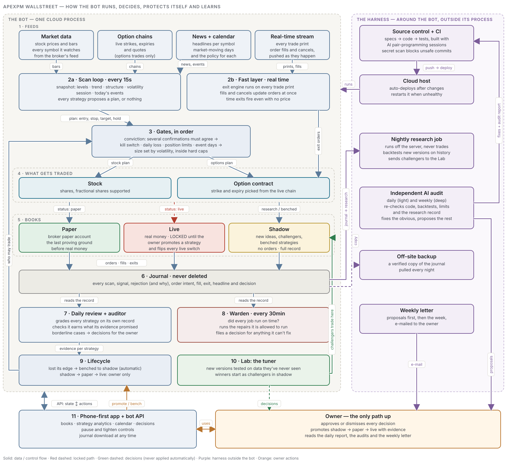

# Architecture

The system is a flow: market data → a snapshot → strategies → a conviction gate → a risk layer → one of three books → a journal → the roles that judge, tune and police it. The same strategy code runs live and in the backtester, so a strategy is tested on exactly the code that trades it.

## Two speeds

- **The scan loop** builds a snapshot of every symbol and asks every registered strategy for a signal.
- **The real-time layer** streams every trade print and order update. Each print updates the price cache and runs the exit engine for open positions in that symbol, so exits fire within about a second. Fills, partial fills and cancels are pushed, not polled.

## The snapshot

Every scan computes, from completed bars only: key price levels, a trend stack, market structure (swings, breaks of structure, imbalances, reactions at key levels), a volatility read, the trading session, and the day's context from the market calendar (events and the policy for them). Headlines are journaled so trades can be read against what the tape knew.

## Signals and gates

A signal carries an entry, stop, target, maximum hold and the level it is aiming for. Strategies never manage exits and never talk to the broker.

1. **Conviction gate.** Several independent yes/no confirmations are counted; below the floor the signal is rejected, and the journal records which confirmations fired.
2. **Risk layer (always on, every book).** Kill switch on total equity, daily loss limit, position and exposure limits, duplicate guard, stop cooldown, event-day rules and entry/flat-by cutoffs. Sizing is fractional Kelly scaled to volatility, capped by hard notional limits. Risk profiles can only scale inside the hard ceilings, never above them.
3. **Options.** An options wrapper turns an underlying signal into a contract position: it picks a liquid strike and expiry from the live chain and expresses entry, stop and target in premium terms.

## Books

| Book | Who is in it | Orders |
|---|---|---|
| Live | strategies the owner promoted to live | real |
| Paper | strategies proving themselves | broker paper account |
| Shadow | new ideas, tuned challengers and benched strategies | none; every signal journaled |

A strategy's book follows its status, and the risk layer runs the same gates on all three, so shadow and paper records compare like for like before a promotion.

## Journal

One SQLite file on durable storage: trades (with the book, the stop at entry and the exit plan history), rejections, scans, events, decisions, calendar and headlines. Every order is written as an intent row first, then the order, then the fill. A broker paper-account reset changes the balance, not the journal. Deposits and withdrawals are recorded so performance baselines move without rewriting history. The journal can be snapshotted and downloaded from the app at any time.

## Roles that judge, tune and police

- **Daily review.** Grades every strategy on its own record (expectancy, profit factor, drawdown, discipline) and benches a strategy that has lost its edge. Borderline cases become decisions for the owner. Nothing un-benches itself.
- **Auditor.** Checks that each paper and live strategy is earning what its evidence promised and is not giving profits back.
- **Nightly tuner.** Tests new combinations of each strategy's settings on train, validate and test periods it has never seen, remembering everything it has tried. A challenger is proposed only when it is positive on every period and beats the incumbent. Challengers start in the shadow book; promotion goes through the same gate as every strategy.
- **Warden.** Every half hour, checks that every role did its job on time, runs the repairs it is allowed to run, and files a decision for anything it can't fix.
- **Independent AI audit.** A separate reviewer reads the code and the record daily (light) and weekly (deep), fixes the obvious, and turns everything else into decisions.

## Lifecycle

`research (shadow) → paper → live` happens only by the owner's decision, with evidence. `any → quarantine` is automatic. The owner sees every pending decision in the app and in the daily report.

## Owner surfaces

A phone-first app (books, bot status, analytics per strategy, calendar, decisions, pause and tighten controls), a daily report and a weekly letter.
