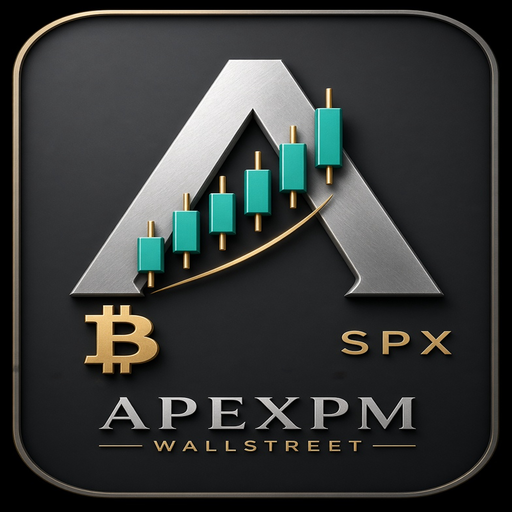
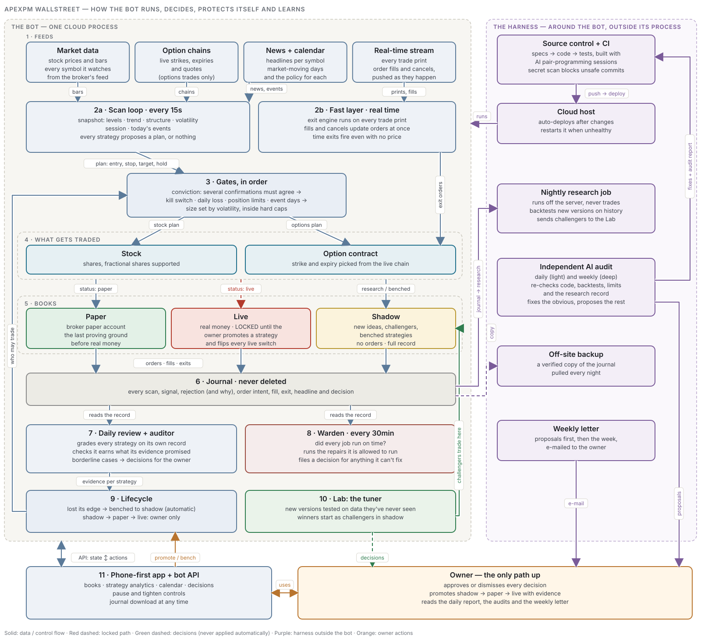

<p align="center"></p>

# ApexPM Wallstreet

**An autonomous trading agent for US stocks and options. Every trade must pass a conviction check and a risk layer that cannot be bypassed. Strategies earn their way from a no-money shadow book to paper to live, and a set of review agents grades, tunes and polices the whole system every day.**

This is the public framework. The strategies, their settings and the research behind them stay in the private build; an example strategy shows how the pieces fit.

<p align="center"></p>

## How it works, in plain terms

1. **It watches** market prices, option chains, headlines and a calendar of market-moving days, plus a live stream of every trade print and order fill.
2. **It builds a snapshot** of every stock on every scan: key price levels, trend, market structure, volatility, time of day and today's events.
3. **Strategies propose complete plans.** Each one answers with an entry, a stop, a target and how long to hold, or with nothing. Strategies never place orders and never manage exits.
4. **Two gates decide.** A conviction gate requires several independent confirmations to agree. A risk layer that cannot be bypassed then applies the kill switch, daily loss limit, position limits and event-day rules, and sizes the trade to the market's volatility. Options trades pick the contract from the live chain.
5. **Three books.** *Shadow* records what a strategy would have done, with no orders. *Paper* trades a broker paper account. *Live* uses real money, only for strategies the owner promoted.
6. **Exits fire within a second** of the price reaching the plan's stop or target, from the real-time stream, in every book.
7. **Everything is journaled** (every scan, signal, rejection, order, fill and exit, with the reason) and never deleted.
8. **It learns and polices itself.** A daily review grades each strategy on its own record and benches losers automatically. A nightly tuner tests new versions on data they have never seen, and winners start in the shadow book. A warden checks that every job ran on time. An independent AI audit reviews the code and the record daily and weekly.
9. **The owner is the only path up.** Nothing is promoted to paper or live without evidence and a human decision. The phone-first app shows the books, the decisions waiting, and a pause button.

## Safeguards

- Paper and dry-run are the defaults. In dry-run the broker wrapper refuses every order, independently of the loop.
- A strategy can only place orders if its status **and** the global switches allow it.
- The kill switch and the halted state survive restarts.
- Exits follow the plan stored at entry, so a later change can't move a live trade's stop.
- Secrets live only in `.env` and are never printed or committed.

## How I built it

I specified the system and owned the decisions: the strategy framework, the risk rules that cannot be bypassed, the governance rules for promoting a strategy from research to paper to live, and the trading logic itself. I ran it as a spec-driven build with Claude Code handling implementation under my review, and I made every promotion call. I had the code put through independent review passes before trusting it, and those caught two defects that shaped the framework: a same-bar look-ahead in an early backtester, and a paper-order path that assumed fills. Both are now covered by tests.

## For developers

```bash
python3 -m venv .venv && .venv/bin/pip install -r requirements.txt
cp .env.example .env                        # add your broker PAPER keys
.venv/bin/python -m apexpm --check          # config + connectivity
.venv/bin/python -m apexpm --once           # one scan, then exit
.venv/bin/python -m apexpm --dashboard      # http://127.0.0.1:8788
.venv/bin/python -m pytest
```

More detail: [ARCHITECTURE.md](ARCHITECTURE.md) · [GOVERNANCE.md](GOVERNANCE.md)

## Disclaimer

This is research software. It is not financial advice and it will lose money if you point it at a strategy without an edge. Paper trade first. Nothing here is a recommendation to trade.

## License

MIT. Built by [mlb707dev](https://github.com/mlb707dev).
